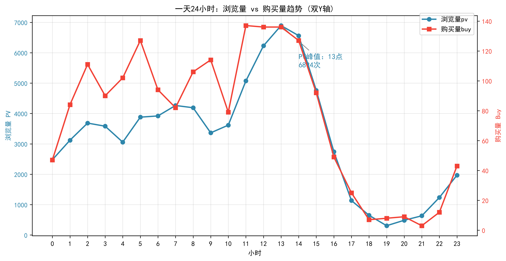
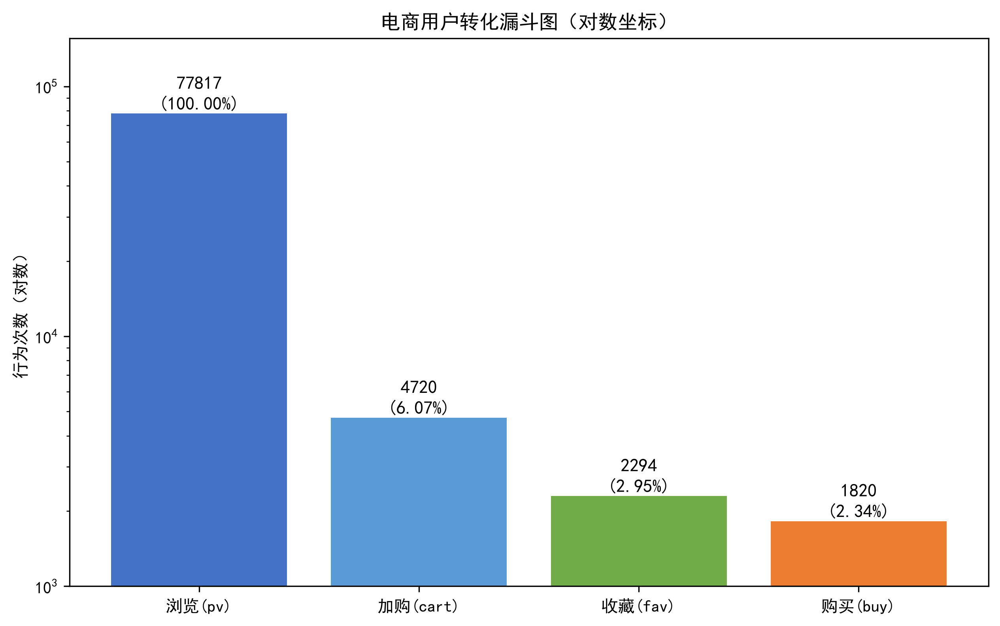
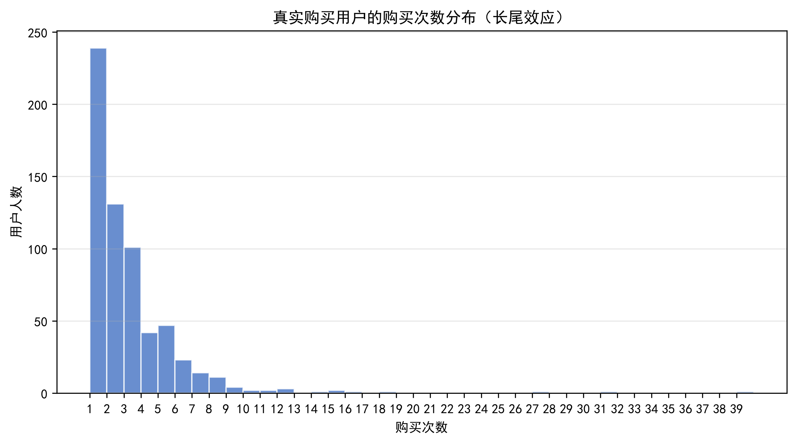
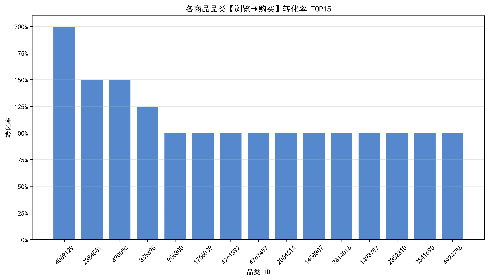

# 淘宝电商用户行为数据分析 (Taobao User Behavior Analysis)

基于百万级淘宝用户行为数据集，使用 Python (Pandas/Matplotlib) 和 MySQL 进行全链路的数据清洗、质量评估与多维度业务分析。

## 🛠 技术栈
- **数据处理**: Python (Pandas, Numpy)
- **数据库**: MySQL (多表关联、聚合、CTE 窗口函数)
- **可视化**: Matplotlib (双 Y 轴、对数漏斗图、直方图)
- **工程化**: 基于 `os.path` 的绝对路径管理，一键生成数据与图表

## 📊 核心分析模块与业务洞察

### 1. 数据质量与预处理
- **处理逻辑**：过滤异常时间戳，剔除超范围数据，避免样本分布偏移。
- **AI 数据视角**：识别出电商用户存在极端长尾分布（多数用户0购买），提示在后续分类建模中需考虑正负样本不均衡问题。

### 2. 24小时时间维度分析
- **处理逻辑**：使用 `twinx()` 构建双 Y 轴折线图，解决 PV（7万+）与 Buy（千级）量级碾压问题。
- **业务洞察**：白天流量极高，但深夜时段用户转化率更高。**流量高峰 ≠ 转化高峰**。


### 3. 用户行为转化漏斗
- **处理逻辑**：动态计算各环节流失，采用**对数坐标 (Log Scale)** 展示，防止尾部转化柱子消失。
- **业务洞察**：浏览到购买的最终转化率约为 2.34%，加购到购买的转化率高达 38.56%。


### 4. 用户复购长尾分布
- **处理逻辑**：剔除 0 次浏览用户，单独统计真实购买用户的频次分布。
- **业务洞察**：呈现典型的长尾效应，绝大多数用户仅购买 1 次，高复购用户极少，业务重心应偏向首单转化及留存。


### 5. 品类转化率 TOP15
- **处理逻辑**：按 `category_id` 分组统计 PV/Buy，计算转化率并排序。
- **业务洞察**：识别出高流量低转化的类目，需重点排查商品详情页或价格策略。


## 📁 项目结构
```text
├── data/              # 数据说明（样本）
├── src/               # Python 数据处理与可视化脚本 (01-05)
├── sql/               # SQL 分析脚本
├── figures/           # 生成的高清分析图表
└── reports/           # 数据质量与业务报告
